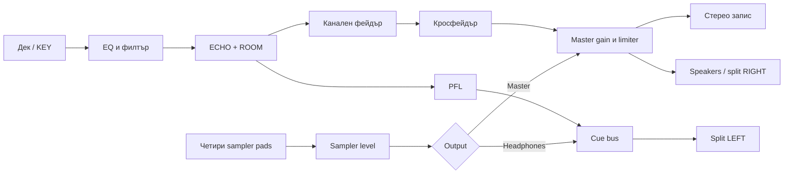

# FX и sampler във версия 0.5

## Управление

Всеки дек има ECHO и ROOM под cue/loop контролите. ECHO се настройва с количество и деление ¼, ½, 1 или 2 удара. Времето следва оригиналния BPM и текущото темпо, включително BEAT SYNC. При липсващ BPM темповото ехо е изключено; ROOM остава наличен. RESET FX връща двете количества на нула и изчиства вътрешните буфери.

Ехото използва ограничен feedback 0.35 с нискочестотно затихване. ROOM е стерео convolution reverb с детерминирано генерирана 1.2 s impulse response. Няма изтеглени IR/sample активи. Пауза на източника оставя естествената FX опашка. Каналната сила и кросфейдърът контролират и опашките. Зареждането на друг трак изчиства старите FX буфери.

Sampler има четири one-shot pads. Избери PAD, трак от FROM YOUR COLLECTION, START и LENGTH (0.05–30 s), след това Load sample. Pad се задейства с натискане или Z/X/C/V; повторното натискане заменя предишния voice на същия pad. Различни pads могат да звучат едновременно. Shift-click изчиства назначението, без да изтрива оригиналния трак. Stop samples спира всички sampler voice-ове; Space спира и дековете.

Нивото на sampler е независимо от каналните фейдъри и кросфейдъра. OUTPUT=Master изпраща към master обработката и записа. OUTPUT=Headphones изпраща само към cue bus. За физическо слушане на този bus е нужен split режим от Audio настройките; в нормален стерео режим той остава нечуваем.

Назначенията, откъсите, sampler нивото и маршрутът се пазят в localStorage на този адрес. Аудио буферите не се дублират в постоянен storage: след презареждане се подготвят от запазената IndexedDB библиотека при първо задействане. За подготовка преди сет избери желания pad и Load sample. Първото задействане след reload може да има изчакване за декодиране. FX количествата започват от нула при ново отваряне.

## Аудио път

## Проверени свойства

Общият набор е 14 Node проверки и 34 browser audio проверки. FX/sampler частта включва:

- sample-identical dry path при FX=0;
- реално пристигане на echo при избраното деление след промяна на темпото;
- channel/crossfader изолация на опашките и PFL преди фейдъра;
- finite room decay и изчистване на старото FX съдържание при смяна на трак;
- реален trim и natural end на семпъл;
- четири едновременни pads, независимо спиране, retrigger без удвояване и Stop samples;
- master sampler независимо от deck controls и headphone sampler извън master;
- действително записване и декодиране на master sampler и FX, без headphone-only sampler; отделна проверка на записаната FX опашка след спиране на сухия източник.

Chrome UI потвърди четири READY назначения, четири едновременно PLAYING pads, запазване след reload, Shift-clear на pad 4 и запазено празно състояние след reload, повторно назначаване и клавиш Z. В headphone-only режим master meter е 0. Маршрутът е върнат на Master след проверката.

Живият тест използва два KEY дека, 139.2 BPM, ECHO на A 40% / 1 beat / 431 ms, ROOM A 30%, ROOM B 20% и четирите sampler pads. Снимка: `output/orbit-performance-0.5.jpg`. Записът `output/recording-performance-0.5.webm` е 43.4385 s стерео Opus/48 kHz, 526340 bytes, mean −31.7 dBFS и peak −11.1 dBFS. Той включва около 14 s крайна тишина след завършването на demo траковете и FX опашките. Silence detector (−60 dBFS, минимум 50 ms) отчита начална пауза до 0.4445 s и тишини чак след 28.7746 s; няма такива интервали между тях. Това не е 43 s непрекъснато активно изпълнение и не доказва продължителна сценична надеждност.

## Оставаща работа

Няма sampler loop/gate режими, sample quantize, банки или MIDI mapping. Не е завършена оценка върху разнообразни реални музикални файлове и дълги сесии. Автоматизираният file chooser още е ограничен от Chrome extension permission; тази проверка използва оригиналната локална demo колекция. Самостоятелно потребителско прослушване и физически устройства остават отделни приемателни проверки.
